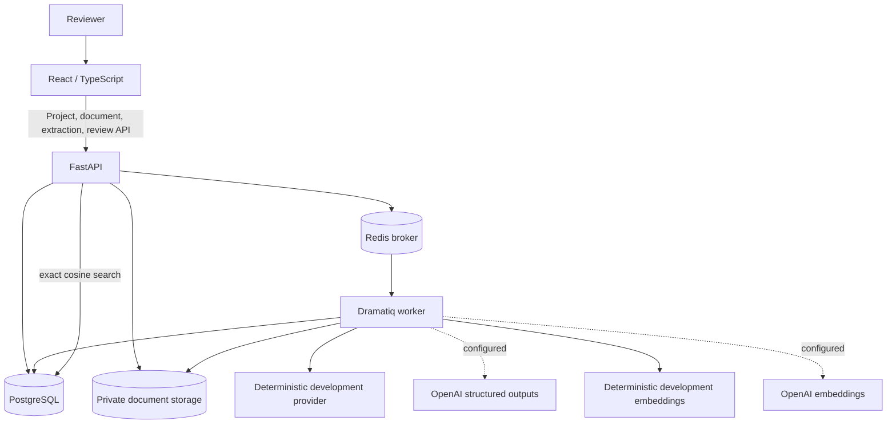

# AssureAI architecture

## Current system

AssureAI remains a modular monolith with separately runnable web, API, and worker
processes. Milestone 3 preserves ingestion and structured extraction while adding
version-safe chunk embeddings, pgvector semantic search, and retrieval-only evaluation.

PostgreSQL uses the pgvector image and the Milestone 3 migration safely enables the
vector extension. Exact vector search is intentional for the small demo dataset.

## Module boundaries

- apps/web: typed API clients, TanStack Query hooks, reusable states, and project/document
  screens.
- apps/api: HTTP routes, ingestion/extraction services, provider-neutral Pydantic
  contracts, provider adapters, evidence validation, SQLAlchemy models, migrations,
  text extraction, chunking, storage protocol, and queue actors.
- apps/worker: the Dramatiq discovery entry point; processing logic stays in the shared
  API application package.
- docs/adr: durable decisions and tradeoffs.
- sample-data: synthetic, non-sensitive demonstration inputs.

The dependency direction is:

    HTTP routes / Dramatiq actor
                |
        application services
                |
      models and storage protocol
                ^
    SQLAlchemy / local storage adapters

HTTP handlers validate transport concerns and map domain errors. Services own
transactions and workflow orchestration. The worker does not duplicate extraction logic.

The AI provider protocol receives only an immutable prompt and controlled source chunks.
Vendor response objects do not cross the adapter boundary.

## Ingestion flow

1. The API verifies the project exists.
2. It reads at most the configured limit plus one byte.
3. Validation checks the display filename, allowed extension, declared MIME type, and
   PDF signature, DOCX container structure, or UTF-8 TXT content.
4. SHA-256 is computed and checked within the project.
5. A generated storage key and UPLOADED metadata row are created.
6. The private file is saved, status becomes QUEUED, and the transaction commits.
7. A Dramatiq message is sent to Redis and HTTP 202 is returned.
8. The worker sets PROCESSING and extracts normalized segments.
9. Existing chunks are deleted and deterministic replacements are inserted in one
   transaction.
10. Metadata and READY are committed. Any exception instead commits FAILED with a safe
    error message and remains visible to Dramatiq retry handling.

## Persistence

The Milestone 1 migration creates:

- projects
- documents
- document_chunks
- the document_status enum

Documents have a foreign key to projects with ON DELETE CASCADE. Chunks have a foreign
key to documents with ON DELETE CASCADE. Project ownership therefore controls the full
ingestion aggregate. This behavior is intentional: deleting a project in a future API
must explicitly confirm removal of metadata and chunks, and the application must also
delete associated stored objects.

The unique constraints on project/content hash and document/chunk index enforce
deduplication and retry idempotency at the database boundary.

The Milestone 2 migration adds:

- prompt_templates and immutable prompt_versions
- extraction_runs with provider/model/prompt/latency/token/failure metadata
- extracted_fields with raw, normalized, corrected, review, and support state
- extraction_evidence tied to stored document chunks
- audit_events for extraction and field-review lifecycle changes

Document and extraction statuses are deliberately separate. Historical completed runs
are immutable; a later extraction creates a new run.

The Milestone 3 migration adds:

- embedding_runs with a separate QUEUED/PROCESSING/COMPLETED/FAILED lifecycle
- document_chunk_embeddings with pgvector vectors and compatibility metadata
- retrieval_evaluation_runs and per-case stored ranked results

One active embedding is allowed per chunk. Historical run metadata is retained, while
active vectors are replaced only after every batch succeeds.

## Embedding and retrieval flow

1. A user explicitly requests embeddings for a READY document.
2. The API records the configured provider, model, dimensions, and embedding version.
3. The worker commits PROCESSING and loads all persisted chunks in stable order.
4. Chunks are sent to the provider in configurable batches.
5. Counts, dimensions, provider, and model are validated for every response.
6. The complete vector set replaces prior active vectors in one transaction.
7. Search embeds the query with the configured provider.
8. Exact cosine distance runs only across matching project, optional document,
   provider, model, and dimension rows.
9. The API returns ranked chunks with cosine similarity, source metadata, and latency.
10. Missing compatible vectors return HTTP 409; no keyword fallback or answer model runs.

PostgreSQL uses pgvector operators in production. SQLite tests calculate the equivalent
cosine similarity after applying the same compatibility and scope filters. No
approximate vector index is used because the demo corpus is small.

Retrieval evaluation accepts explicit relevant chunk IDs, executes real stored searches,
and persists per-case rank, hit, recall, and reciprocal rank plus aggregate Hit@K,
Recall@K, and MRR.

## Structured extraction flow

1. The API verifies project/document scope and READY status.
2. It assigns Inspection Extraction Prompt v1, creates QUEUED, audits, and enqueues.
3. The worker commits PROCESSING before calling the selected provider.
4. Chunks are supplied as CHUNK_ID/PAGE/TEXT blocks.
5. Provider JSON is validated by the Pydantic inspection schema.
6. Chunk ownership, stored page bounds, and normalized quote inclusion are validated.
7. Invalid references are discarded and support status is downgraded.
8. Fields/evidence and COMPLETED metadata commit atomically.
9. Retried completed jobs return immediately; replacement prevents duplicates.
10. Provider/schema/runtime failures commit FAILED and a safe audit event.

Review stores corrected values separately from original AI values. VERIFIED, CORRECTED,
and REJECTED decisions are one-time in this milestone and produce audit events. Reviewer
is null because authentication does not yet exist.

## Project isolation

Document detail and chunk requests query by project_id and document_id together. A valid
document identifier presented through another project returns 404. Duplicate checks are
also project-scoped. Storage keys never cross the HTTP boundary.

Authentication and user ownership are deferred, so Milestone 1 isolation protects
project boundaries within the current unauthenticated application but is not a complete
multi-tenant authorization system.

## Text preparation

PDF extraction retains one-based page numbers. DOCX extraction retains paragraph order
and section labels. TXT uses UTF-8 with optional BOM. Normalization standardizes line
endings, removes control noise, collapses horizontal whitespace, and preserves paragraph
breaks.

Chunks target 1,000 characters and respect paragraph boundaries. PDF pages do not mix.
A 150-character overlap is applied only when splitting one oversized paragraph. This is
deterministic preparation, not embedding-aware chunking.

## Reliability and operations

- /health reports only process liveness.
- /ready checks the database and Redis when configured.
- API startup applies Alembic migrations in the container.
- API and worker share a named local-storage volume.
- JSON lifecycle logs contain project/document/run/field identifiers but not extracted
  content, evidence quotes, or provider keys.
- Chunk replacement is transactional and safe to repeat.
- Queue submission failure is recorded as FAILED and returned as service unavailable.

Local filesystem storage is suitable for Compose and a single host. A production
multi-host deployment requires an object-storage adapter, managed secrets, TLS,
backups, monitoring, and an explicit migration job.

## Deferred work

Authentication, RAG answers, generated answer citations, chat, agents, general tool
calling, OCR, and the full evaluation framework are not implemented in Milestone 3.

## Decisions

See [docs/adr](docs/adr), especially:

- ADR 0004: Dramatiq with Redis
- ADR 0006: document storage abstraction
- ADR 0007: project-scoped content deduplication
- ADR 0008: deterministic document chunking
- ADR 0009: structured inspection extraction schema
- ADR 0010: immutable prompt versioning
- ADR 0011: controlled chunk evidence validation
- ADR 0012: preserve original values during human review
- ADR 0013: provider-neutral embedding interface
- ADR 0014: dedicated active chunk embeddings in pgvector
- ADR 0015: cosine similarity retrieval
- ADR 0016: transactional active-vector replacement
- ADR 0017: deterministic retrieval-only evaluation
