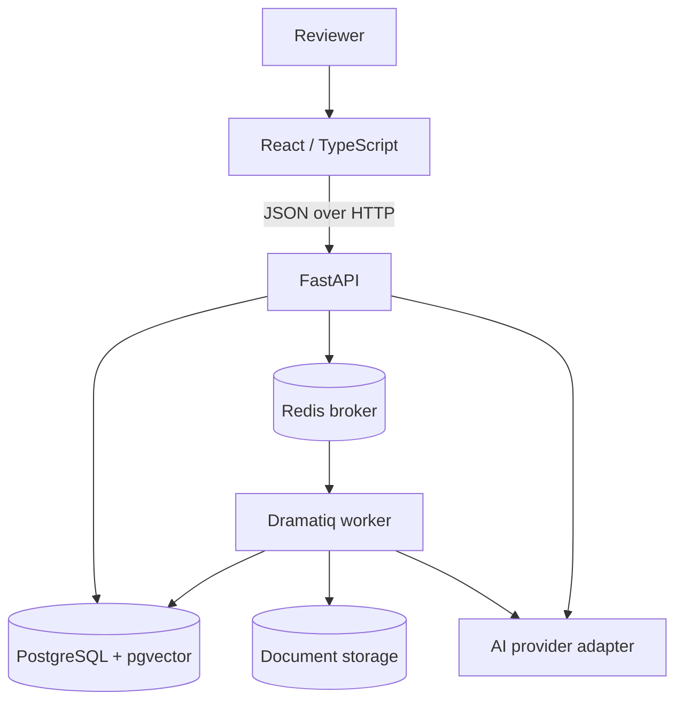

# AssureAI architecture

## Goals

AssureAI is organized as a modular monolith with separately deployable web, API, and worker processes. This keeps the initial system understandable while preserving hard boundaries around background processing, persistence, retrieval, and AI providers.

## System context



Document storage is represented as a boundary: local development can use a mounted volume, while a later deployment may use object storage without exposing storage paths to clients.

## Repository boundaries

- `apps/web`: browser application, reusable UI, API client, and query hooks.
- `apps/api`: HTTP composition root plus future application, domain, persistence, and provider-adapter modules.
- `apps/worker`: worker process configuration. It imports application services from the installable API package rather than duplicating domain logic.
- `docs/adr`: durable architectural decisions and their tradeoffs.
- `sample-data`: synthetic/public non-sensitive inputs only (introduced with the vertical slice).

The Python package will evolve toward these inward dependencies:

```text
HTTP routes / worker actors
          |
application services
          |
domain models and protocols
          ^
persistence, storage, and AI adapters
```

## Intended document flow

1. The API authenticates the caller, authorizes the project, validates the upload, hashes its content, and persists metadata.
2. The API places an idempotent job identifier on Redis and returns a processing status.
3. A worker extracts and normalizes text, preserves page/section provenance, chunks content, and persists state transactionally.
4. Later stages create embeddings and schema-validated extracted fields. Every trusted field retains evidence and review status.
5. Retrieval always applies project scope before similarity search. Generated citations can reference only retrieved, stored chunks.
6. Audit and evaluation records make consequential operations reproducible and reviewable.

Steps 1–3 are Milestone 1; AI extraction and RAG are later milestones.

## Domain direction

The full conceptual model includes users, projects, documents and versions, chunks, jobs, extracted fields, verification rules/results, conversations, questions/answers/citations, prompt versions, evaluation runs/cases, and audit events. Only projects, document metadata/versions, extraction jobs, and chunks should be implemented for Milestone 1 unless a concrete need proves otherwise.

## Trust boundaries

- Browser input, uploaded files, extracted document text, and AI output are untrusted.
- Project identity is server-derived and enforced in every repository/retrieval operation.
- AI output is advisory until schema validation and, where required, human review succeed.
- Secrets never cross the API/worker boundary into frontend artifacts.
- File names are display metadata, not storage paths.

## Reliability and observability

- `/health` is process liveness; `/ready` is dependency readiness.
- JSON logs include service, environment, severity, timestamp, and request ID when available.
- Background work is retryable and will use explicit idempotency/status transitions.
- AI calls will capture provider/model, prompt version, latency, usage, and errors without logging secrets or sensitive document bodies.
- OpenTelemetry is deferred until real cross-service traces exist.

## Deployment

Docker Compose provides the local topology. Production may independently scale the static web app, stateless API, and worker processes; it requires managed secrets, durable object storage, backups, TLS termination, migration execution, and monitoring that are intentionally outside Milestone 0.

## Decisions

See the accepted records in [`docs/adr`](docs/adr):

- ADR 0001: monorepo and modular monolith
- ADR 0002: FastAPI API
- ADR 0003: PostgreSQL with pgvector
- ADR 0004: Dramatiq with Redis
- ADR 0005: provider-independent AI interfaces
