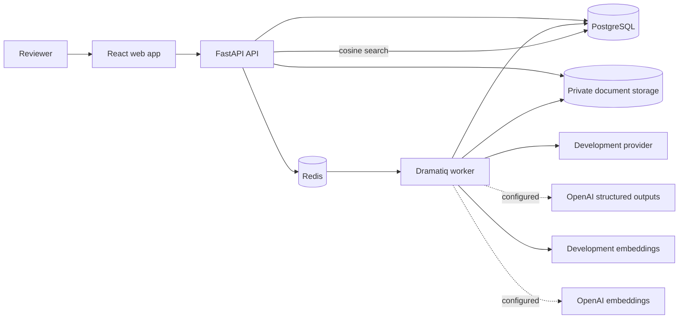

# AssureAI

AssureAI is a document-intelligence application for traceable technical-assurance
workflows. Milestone 3 adds pgvector embeddings, project-isolated semantic retrieval,
and retrieval-only evaluation without adding generated answers.

> **Status:** Milestones 0-3 are implemented. The Azure demo uses deterministic
> development AI and embedding providers. RAG answers, generated citations, chat,
> agents, OCR, and the full evaluation framework remain planned.

## Implemented

- Create, list, and inspect isolated projects.
- Upload PDF, DOCX, and UTF-8 TXT documents up to a configurable size.
- Validate extension, declared MIME type, and basic file structure/signature.
- Store files under private generated keys through a storage abstraction.
- Protect against duplicate content within a project using SHA-256 and a database
  uniqueness constraint; duplicates return HTTP 409.
- Queue extraction through Redis and Dramatiq.
- Extract PDF text by page, DOCX text by ordered paragraph, and TXT text as UTF-8.
- Normalize and deterministically chunk text while retaining page/section provenance.
- Persist UPLOADED, QUEUED, PROCESSING, READY, and FAILED states.
- Poll active processing from the React interface and display chunks or safe errors.
- Scope every document and chunk lookup by both project and document identifier.
- Apply PostgreSQL schema changes with Alembic.
- Queue structured inspection extraction as a separate Dramatiq job and status model.
- Select a deterministic offline or OpenAI provider through backend configuration.
- Validate every provider response with a Pydantic v2 inspection schema before storage.
- Persist immutable prompt versions and provider/model/latency/token metadata.
- Validate chunk ownership, page metadata, and evidence quotes before accepting evidence.
- Mark fields SUPPORTED, PARTIALLY_SUPPORTED, or UNSUPPORTED.
- Preserve original AI values while reviewers verify, correct, or reject fields.
- Persist extraction and field-review audit events without document contents.
- Poll extraction runs, display evidence and history, and review fields in the React UI.
- Generate chunk embeddings explicitly through a separate Dramatiq lifecycle.
- Store one active, versioned embedding per chunk in PostgreSQL pgvector.
- Batch embedding calls and replace stale document vectors transactionally.
- Select deterministic development or OpenAI embedding providers through backend config.
- Search project or document scopes with exact cosine similarity and bounded top-k.
- Reject searches without compatible provider/model/dimension vectors.
- Persist retrieval-only Hit@K, Recall@K, MRR, and per-case ranked evidence.
- Display embedding status, ranked source chunks, and retrieval metrics in React.

## Planned, not implemented

- RAG-generated answers and validated answer citations
- Conversation/chat, agents, and general tool calling
- OCR and image-only document processing
- Full AI evaluation framework and evaluation operations dashboard
- Authentication and multi-user authorization
- Production object storage

## Architecture

See [ARCHITECTURE.md](ARCHITECTURE.md) and [docs/adr](docs/adr).

## Run with Docker Compose

Requirements: Docker Desktop with Compose.

1. Copy .env.example to .env. The default AI provider is deterministic, offline, and
   intended only for development, tests, and demos.
2. Start the stack:

       docker compose up --build

3. Open:

   - Web: <http://localhost:5173>
   - API documentation: <http://localhost:8000/docs>
   - Liveness: <http://localhost:8000/health>
   - Dependency readiness: <http://localhost:8000/ready>

The API applies Alembic migrations before starting. PostgreSQL, Redis, and uploaded
documents use named volumes. API and worker share the private document volume.

To exercise the vertical slice, create “Wind Farm Alpha” and upload a file from
[sample-data](sample-data). The included data is synthetic.

## Run without Docker

Use Python 3.12+ and Node 22.

API:

    cd apps/api
    python -m venv .venv
    # Activate the environment for your shell.
    python -m pip install -e ".[dev]"
    # Set ASSUREAI_DATABASE_URL and ASSUREAI_REDIS_URL.
    alembic upgrade head
    uvicorn assureai_api.main:app --reload

Worker:

    # From the repository root with the API environment active:
    set PYTHONPATH=apps/api/src;apps/worker/src
    dramatiq assureai_worker.tasks

Web:

    cd apps/web
    npm ci
    npm run dev

## API behavior

Project endpoints:

- POST /api/v1/projects
- GET /api/v1/projects
- GET /api/v1/projects/{project_id}

Document endpoints:

- POST /api/v1/projects/{project_id}/documents
- GET /api/v1/projects/{project_id}/documents
- GET /api/v1/projects/{project_id}/documents/{document_id}
- GET /api/v1/projects/{project_id}/documents/{document_id}/chunks

Extraction endpoints:

- POST /api/v1/projects/{project_id}/documents/{document_id}/extractions
- GET /api/v1/projects/{project_id}/documents/{document_id}/extractions
- GET /api/v1/projects/{project_id}/documents/{document_id}/extractions/{run_id}
- PATCH /api/v1/projects/{project_id}/documents/{document_id}/extractions/{run_id}/fields/{field_id}/review

Embedding and retrieval endpoints:

- POST /api/v1/projects/{project_id}/documents/{document_id}/embeddings
- GET /api/v1/projects/{project_id}/documents/{document_id}/embeddings
- GET /api/v1/projects/{project_id}/documents/{document_id}/embeddings/{run_id}
- POST /api/v1/projects/{project_id}/search
- POST /api/v1/projects/{project_id}/documents/{document_id}/search
- POST /api/v1/projects/{project_id}/retrieval-evaluations
- GET /api/v1/projects/{project_id}/retrieval-evaluations

The upload endpoint accepts multipart/form-data and returns HTTP 202 after durable
metadata/file storage and successful queue submission. The same SHA-256 content in the
same project returns HTTP 409 and identifies the existing document. Storage keys and
host paths are never returned.

## Processing and chunking

The worker sets PROCESSING, parses and normalizes text, replaces existing chunks in one
transaction, and then sets READY. Failures set FAILED with a safe message and are logged
without document contents. This replacement strategy makes retries idempotent.

Paragraphs are packed toward 1,000 characters. Separate PDF pages are never combined.
Only a single oversized paragraph is split with approximately 150 characters of
overlap. See [ADR 0008](docs/adr/0008-deterministic-document-chunking.md).

## Structured extraction and review

Extraction is allowed only for READY documents. POST creates a QUEUED ExtractionRun and
returns HTTP 202. The worker moves it to PROCESSING, supplies controlled chunk IDs to
the configured provider, validates the response against the Pydantic schema, validates
evidence against stored chunks, then atomically persists fields/evidence and marks the
run COMPLETED. Failures become FAILED with safe codes/messages.

The deterministic development provider makes no network calls and is recorded as
"development / deterministic-development-v1". To use OpenAI, configure
ASSUREAI_AI_PROVIDER=openai, ASSUREAI_OPENAI_API_KEY, and ASSUREAI_OPENAI_MODEL only in
backend secrets. The adapter uses structured outputs; arbitrary JSON is never directly
persisted.

Review decisions never overwrite raw_value or normalized_value. Corrections use a
separate value, while verification/rejection/correction events retain timestamp, reason,
and a null reviewer until authentication is implemented.

## Embeddings and semantic retrieval

Embedding generation is explicit and allowed only for READY documents. A QUEUED
EmbeddingRun is processed in configurable batches. All returned vectors are validated
against the run provider, model, dimensions, and count before the prior active document
vectors are replaced transactionally. Failed re-embedding leaves the prior complete set
available; retrying a completed run is a no-op.

The development provider is deterministic, offline hashing intended only for tests and
demos. Configure ASSUREAI_EMBEDDING_PROVIDER=openai,
ASSUREAI_OPENAI_EMBEDDING_MODEL, ASSUREAI_EMBEDDING_DIMENSIONS, and a backend-only
ASSUREAI_OPENAI_API_KEY to use the real adapter.

Search embeds the query with the configured compatible provider and uses exact pgvector
cosine distance, returning cosine_similarity = 1 - distance. Every SQL search includes
project, optional document/page, provider, model, and dimension filters. There is no
keyword fallback and no LLM-generated answer.

The synthetic retrieval cases live in
[sample-data/evaluation](sample-data/evaluation). Evaluation persists real ranked
chunk IDs and calculates Hit@K, Recall@K, and mean reciprocal rank without an LLM judge.

## Quality checks

Backend, from apps/api:

    ruff check .
    ruff format --check .
    mypy src tests
    pytest

Frontend, from apps/web:

    npm run format:check
    npm run lint
    npm run typecheck
    npm test -- --run
    npm run build

Infrastructure:

    docker compose config --quiet
    docker compose build

## Single-VM demo deployment

The production Compose file serves the built React application through Nginx, proxies
same-origin API requests, keeps PostgreSQL and Redis off host ports, limits container
memory, and runs one document worker process for a small VM.

On a Linux host with Docker Engine and the Compose plugin installed:

    cp .env.production.example .env.production
    # Replace every placeholder with a unique secret and the host's public origin.
    docker compose --env-file .env.production -f docker-compose.prod.yml up -d --build
    docker compose --env-file .env.production -f docker-compose.prod.yml ps

Only HTTP port 80 is published by this demo configuration. Put TLS termination in
front of the web service before handling sensitive or real customer documents. Back up
the `postgres-data` and `document-data` volumes; deleting them permanently removes
project metadata and uploaded documents.

For the complete Azure Portal and VM procedure used by the live showcase, see the
[Azure single-VM demo deployment guide](docs/deployment/azure-vm-demo.md).

## Security and limitations

Files are checked using bounded reads, allowed extensions, declared types, signatures or
container structure, and UTF-8 decoding. Original filenames are display metadata only.
Project scope is carried through document and chunk queries. Uploaded contents and
secrets are ignored by version control and are never logged.

Milestone 3 has no authentication, malware scanning, OCR, encrypted object storage,
distributed storage adapter, RAG answer generation, citations, or chat. Image-only PDFs fail
cleanly when no extractable text is found. Local filesystem storage and the deterministic
providers are intended for development and the single-host demo.

## Recommended Milestone 4

Use semantic retrieval for controlled context construction, grounded LLM answers,
validated citations, and SUPPORTED / PARTIALLY_SUPPORTED / INSUFFICIENT_EVIDENCE
classification. Do not add chat or agents as part of that step.

## License

MIT. See [LICENSE](LICENSE).
