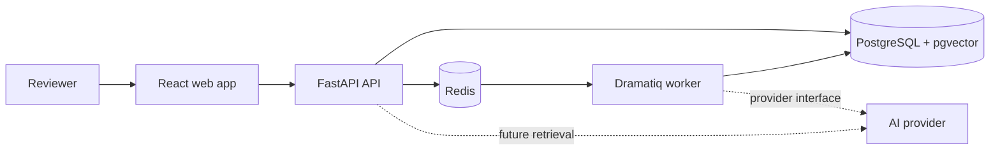

# AssureAI

AssureAI is a production-oriented AI document intelligence and verification platform for technical assurance workflows. It is designed to ingest engineering documents, extract structured facts with evidence, support human verification, and eventually answer document-scoped questions with traceable citations.

> **Status:** Milestone 0 foundation. The repository currently provides the application skeleton, local infrastructure, health/readiness checks, quality tooling, and CI. Document ingestion, extraction, RAG, and evaluation are planned and are not represented as implemented.

## Problem statement

Technical reviews often require people to locate facts across lengthy, inconsistent documents and then prove where those facts came from. AssureAI aims to make that process reviewable: AI output is schema-validated, important values retain source evidence, project boundaries are enforced, and uncertain answers are not silently trusted.

## Architecture



See [ARCHITECTURE.md](ARCHITECTURE.md) and [docs/adr](docs/adr) for boundaries and decisions.

## Technology stack

- Web: React, TypeScript, Vite, React Router, TanStack Query, Tailwind CSS
- API: Python 3.12+, FastAPI, Pydantic v2
- Planned persistence: SQLAlchemy 2, Alembic, PostgreSQL with pgvector
- Background processing: Dramatiq with Redis
- Quality: Ruff, mypy, pytest, ESLint, TypeScript, Vitest
- Delivery: Docker Compose and GitHub Actions

## Local setup

### Docker Compose (recommended)

1. Copy `.env.example` to `.env` and adjust local-only values.
2. Start the stack:

   ```bash
   docker compose up --build
   ```

3. Open the web app at <http://localhost:5173> and API docs at <http://localhost:8000/docs>.

Health endpoints:

- `GET /health` confirms that the API process is alive.
- `GET /ready` confirms that the initialized application is ready to receive traffic. Dependency checks will be added alongside persistence in Milestone 1.

Validate the Compose model without starting services:

```bash
docker compose config
```

### Run without Docker

API (Python 3.12+):

```bash
cd apps/api
python -m venv .venv
# Activate the virtual environment for your shell.
python -m pip install -e ".[dev]"
uvicorn assureai_api.main:app --reload
```

Web (Node 22+):

```bash
cd apps/web
npm ci
npm run dev
```

## Quality checks

```bash
# API, from apps/api
ruff check .
ruff format --check .
mypy src tests
pytest

# Web, from apps/web
npm run lint
npm run typecheck
npm test -- --run
npm run build
```

## AI architecture (planned)

Application services will depend on typed provider protocols, not a vendor SDK. Provider adapters will validate structured outputs before domain data is accepted and will record prompt versions, token usage, latency, and evidence references. A deterministic development provider may be supplied for offline tests and will be clearly identified as non-AI behavior.

## RAG and evaluation (planned)

Retrieval will be project- and document-scoped, with metadata filters and citations tied to stored chunk and page identifiers. Answers will state whether they are supported, partially supported, or have insufficient evidence. Evaluation will persist retrieval, extraction, citation, groundedness, latency, token, and estimated-cost results rather than only printing them.

## Security considerations

Secrets stay in backend environment variables. Planned controls include authenticated project ownership, upload allowlists and size limits, safe filenames, content hashing, cross-project retrieval isolation, audit events, rendered-content sanitization, and prompt-injection-aware processing. No compliance certification is claimed.

## Testing strategy

Milestone 0 includes unit/API health checks and component tests for critical landing-page states. Later milestones add persistence integration tests, upload security and isolation tests, worker tests, evaluation datasets, and Playwright coverage for critical user journeys.

## Deployment architecture (planned)

The containers are independently deployable as a static web frontend, API service, worker processes, PostgreSQL/pgvector, and Redis. Production deployment details will be documented once persistence and jobs exist; the local Compose stack is not itself a production topology.

## Limitations

- No authentication, projects, uploads, extraction, vector retrieval, or AI calls yet.
- Readiness currently reflects application initialization only.
- The dashboard uses honest milestone-status content, not simulated AI data.

## Roadmap

- **Milestone 0 (current):** architecture, tooling, service skeletons, local infrastructure, health checks, CI.
- **Milestone 1 (next):** projects, validated document uploads, content hashing, asynchronous text extraction/chunking, processing status, and isolation tests.
- **Later:** schema-backed AI extraction, human verification, evidence-backed RAG, persistent evaluation, authentication, and observability expansion.

## License

MIT. See [LICENSE](LICENSE).
